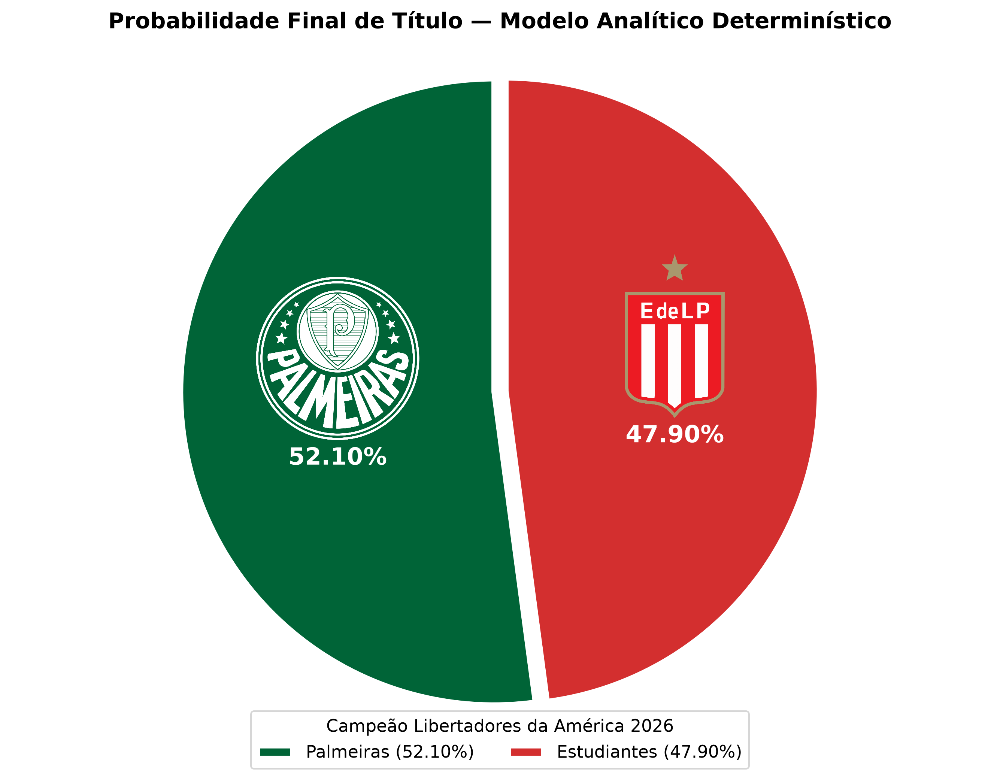
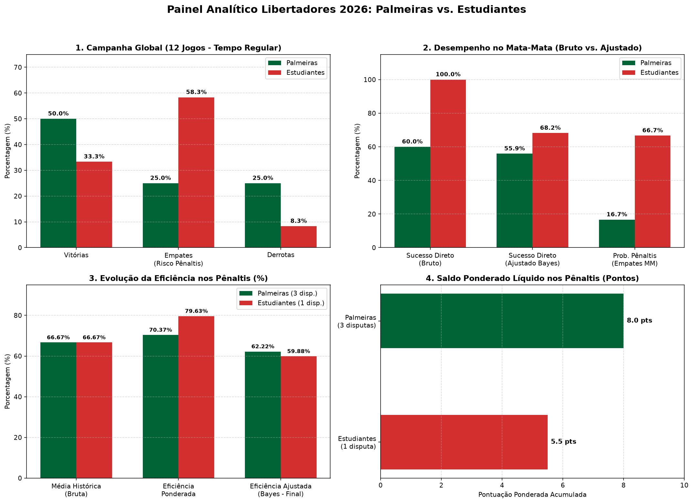
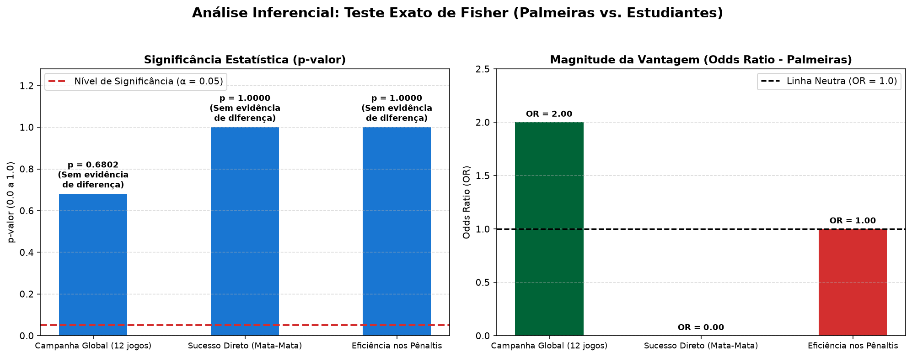

# 🏆 Análise Estatística: Final da Libertadores 2026 (Palmeiras vs. Estudiantes)

> *Esse é meu primeiro projeto em Python, para tal, consultei meus materiais de estudo e também recorri a ferramentas de IA generativa. Tive todo o cuidado de entender o todo, visando pensar na complexidade do projeto, o foco não foi criar o código, mas entender o processo.*

---

## 📊 1. Base de Dados e Auditoria

Os dados consolidam a campanha completa de ambos os finalistas (**12 partidas cada**: 6 da Fase de Grupos + 6 do Mata-Mata), além do histórico detalhado de cobranças em disputas por pênaltis na competição:
**Simetria vs. Assimetria Amostral:** Percebi que enquanto o tempo regulamentar apresentava amostras simétricas (`12 jogos vs. 12 jogos`), as disputas de pênaltis possuiam tamanhos amostrais distintos (`3 disputas / 18 cobranças` do Palmeiras contra `1 disputa / 9 cobranças` do Estudiantes).

---

## 🔬 2. Metodologia Estatística

### A. Tempo Regulamentar (Amostra Simétrica — 12 Jogos)
Utilização das taxas observadas puras na campanha global, sem suavização artificial:
**Palmeiras:** `50.00%` Vitórias | `25.00%` Empates | `25.00%` Derrotas (Saldo líquido: `+3` jogos).
**Estudiantes:** `33.33%` Vitórias | `58.33%` Empates | `8.33%` Derrotas (Saldo líquido: `+3` jogos).
**Os Dados falam:** Como as equipes possuem o mesmo saldo líquido ($V - D = +25.00\%$), tivemos um empate técnico nos 90 minutos (`29.17%` de chance de vitória para cada lado e `41.67%` de empate).

### B. Suavização Bayesiana e Ponderação nos Pênaltis (Amostra Assimétrica)
Percebi que as amostras reduzidas inflavam as taxas de aproveitamento, então criei a seguinte saída:
**Pesos por Modalidade:** Cobranças convertidas (`1.0`), defendidas (`2.0`) e desperdiçadas (`1.5`), normalizadas em escala *Min-Max* (`70.37%` Palmeiras vs. `79.63%` Estudiantes).
2. **Suavização Bayesiana ($k = 2$, Prior $= 50\%$):** Eu desconhecia essa funcionalidade, e foi uma sugestão de uma IA generativa que aprovei a implementação. Ela regularizou a eficiência técnica conforme o volume de disputas (`62.22%` Palmeiras vs. `59.88%` Estudiantes).
3. **Score Composto com Fator Experiência (`80/20`):** Outra sugestão que partiu de mim, uma vez que percebi que um clube tinha amostragem maior que o outro e por consequência, mais "segurança". Ela combina `80%` de eficiência técnica ajustada com `20%` de experiência comprovada em disputas (`3/4 = 75.00%` vs. `1/4 = 25.00%`), resultando em `64.78 pts` contra `52.90 pts` — o que define a probabilidade de vitória nos pênaltis em **`55.04%` (Palmeiras)** contra **`44.96%` (Estudiantes)**.

### C. Teste de Hipótese (Teste Exato de Fisher)
Como estou aprendendo, sugeri erroneamente um teste de Correlação de Pearson (pensei na questão dos pares, como os clubes em disputa, mas não era o caso), então veio a sugestão de uma IA generativa para aplicação do **Teste Exato de Fisher** ($\alpha = 0.05$) em tabelas $2 \times 2$:
**Campanha Global (12 jogos):** $\text{OR} = 2.00$ | $p = 0.6802$
**Sucesso Direto no Mata-Mata:** $\text{OR} = 0.00$ | $p = 1.0000$
**Eficiência Bruta nos Pênaltis:** $\text{OR} = 0.57$ | $p = 0.6758$

> **Veredito:** Todos os cenários apresentaram $p > 0.05$, comprovando um **equilíbrio estatístico** entre os finalistas, apontando que não existe bobo no futebol rs. E que por fim, não existe nenhuma vantagem isolada que supere a margem de variação amostral. A margem de favoritismo do Verdão é estatisticamente irrelevante.

| Indicadores Finais | Palmeiras | Estudiantes |
| :--- | :---: | :---: |
| **Vitória no Tempo Normal (90 min)** | `29.17%` | `29.17%` |
| **Probabilidade de Decisão por Pênaltis** | `41.67%` | `41.67%` |
| **Probabilidade de Vitória nos Pênaltis** | `55.04%` | `44.96%` |
| **Probabilidade Final de Título** | **`52.10%`** | **`47.90%`** |

---

## 📈 3. Visualizações
### Painel Comparativo Geral

### Análise Inferencial (Teste Exato de Fisher)

---

## 🛠️ 4. Tecnologias Utilizadas
- **Linguagem:** Python (`pandas`, `numpy`, `scipy`, `matplotlib`, `Pillow`)
- **Ambiente:** Spyder
- **IA Generativa:** Gemini e Claude
